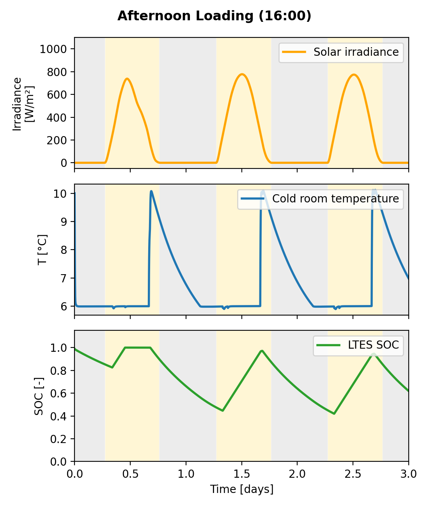

# AGRI-COOL Training – System modelling of a cold room

Teaching material for the module **"System modelling of the cold room"** in the AGRI-COOL advanced training course.

The Modelica package `AgriCoolSimple` models an off-grid cold room for agricultural produce: a PV-driven chiller charges an ice tank, and the ice cools the room through a fan coil. Students change design values in one record and compare scenarios.



## What you can do with it

- Simulate three ready-made scenarios: **morning loading**, **afternoon loading** and a **cloudy day**.
- Change any design value (room size, crop load, PV, chiller, ice mass) in the `design` record.
- Plot irradiance, room temperature and ice state of charge for each run.

## Requirements

- [OpenModelica](https://openmodelica.org/) (tested with OMEdit)
- Modelica Standard Library **4.1.0**
- [Buildings library](https://simulationresearch.lbl.gov/modelica/) **13.0.0**

Install both libraries in OMEdit via *File → Manage Libraries → Install Library*.

## Quick start

1. Download or clone this repository.
2. In OMEdit, open `AgriCoolSimple.mo` (keep it next to the `Resources` folder).
3. Open `Scenarios` and simulate `AfternoonLoading` (3 days).
4. Plot `G`, `room_degC` and `SOC`.
5. Double-click **design** in the diagram, change one value, simulate again, and explain what changed.

Optional: create the three-panel figure with Python

```
python scripts/plot_results.py AfternoonLoading_res.mat "Afternoon Loading (16:00)"
```

## Repository structure

```
AgriCoolSimple.mo          Modelica package (components, system model, scenarios)
Resources/weather/         Weather file used by the model
scripts/plot_results.py    Three-panel plot from an OpenModelica result file
docs/                      Figures and slides
```

## Model in one paragraph

The chiller runs on PV power only and cools a water-glycol loop. The loop passes through an ice tank, which freezes when the glycol is below 0 °C and melts when it is above. The same glycol then feeds the fan coil, so at night the room is cooled by melting ice. A PI controller sets the fan speed to hold 6 °C. Every day a 500 kg crop batch arrives at 20 °C.

**Simplifications:** no battery (pump, fans and controls are assumed to have a separate supply), sensible cooling only, horizontal PV, no solar gain on the room. This is a teaching model, not a validated design tool.

## Weather data

`BoaVista_Rabil_TMYx_2011_2025.mos` is derived from the TMYx dataset of Climate.OneBuilding.org:

> Lawrie, L. K., Crawley, D. B. (2022). *Development of Global Typical Meteorological Years (TMYx).* https://climate.onebuilding.org

The data are provided free of charge by the authors, without warranty. To use another location, download its TMYx file from Climate.OneBuilding.org, convert it to `.mos` and set `weatherFile`.

## License

- Code (`AgriCoolSimple.mo`, `scripts/`): [MIT License](LICENSE).
- Slides and figures in `docs/`: [CC BY 4.0](https://creativecommons.org/licenses/by/4.0/).
- The Buildings library and the Modelica Standard Library are not included and keep their own licenses.

## How to cite

See [`CITATION.cff`](CITATION.cff), or use GitHub's *Cite this repository* button.

## Acknowledgement

Funded by the European Union. Views and opinions expressed are however those of the author(s) only and do not necessarily reflect those of the European Union or CINEA. Neither the European Union nor the granting authority can be held responsible for them.

Developed at the University of Twente within the [AGRI-COOL project](https://www.agricool.eu).
Contact: Bahareh Bakhsh Zahmatkesh – bahareh.bakhshzahmatkesh@utwente.nl
